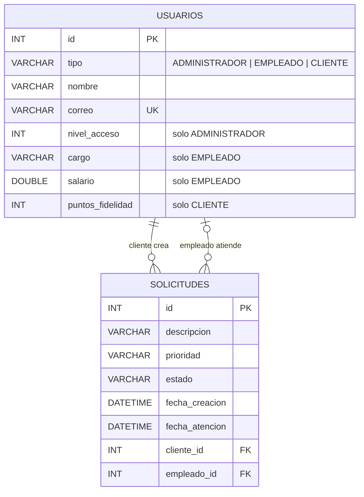

# Evaluación Spring Boot – Gestión de Usuarios y Solicitudes

API REST con Spring Boot para gestionar los usuarios de una plataforma (Administrador, Empleado y Cliente) y las solicitudes de atención que crean los clientes y atienden los empleados.

## Tecnologías

- Java 21 o superior y Spring Boot 4.1.1
- Spring Web MVC (API REST)
- Spring Data JPA + Hibernate
- MySQL (H2 en memoria solo para las pruebas automáticas)
- Jakarta Bean Validation
- Lombok (`@Getter`, `@Setter`, `@NoArgsConstructor`, `@AllArgsConstructor`, `@Builder`, `@RequiredArgsConstructor`)

## Cómo ejecutar

1. Tener MySQL 8 corriendo en `localhost:3306` con usuario `root` y contraseña `root`. Si son distintos, se cambian en `src/main/resources/application.properties`.
2. Ejecutar `src/main/resources/sql/evaluacion.sql` en MySQL Workbench. Crea la base de datos `evaluacion`, las tablas, las restricciones `CHECK` y los datos de prueba. **Ojo:** empieza con `DROP DATABASE`, así que borra lo que hubiera antes. Si no se ejecuta, la aplicación crea la base de datos y las tablas vacías sola.
3. Arrancar la aplicación:

```bash
./mvnw spring-boot:run
```

La API queda en `http://localhost:8080`.

En IntelliJ, si el editor marca en rojo los getters o los setters, hay que activar *Settings → Build → Compiler → Annotation Processors → Enable annotation processing* y tener instalado el plugin de Lombok.

### Pruebas automáticas

```bash
./mvnw test
```

Usan H2 en memoria, así que no necesitan MySQL.

## Endpoints

### Usuarios

| Método | Ruta | Descripción |
|---|---|---|
| POST | `/usuarios` | Crea un usuario. El campo `tipo` define si es `ADMINISTRADOR`, `EMPLEADO` o `CLIENTE` |
| GET | `/usuarios?page=0&size=10&sort=nombre,asc` | Lista paginada y ordenada |
| GET | `/usuarios/{id}` | Busca un usuario por id |

### Solicitudes

| Método | Ruta | Descripción |
|---|---|---|
| POST | `/solicitudes` | Crea una solicitud para un cliente |
| GET | `/solicitudes?estado=PENDIENTE&page=0&size=5&sort=fechaCreacion,desc` | Lista paginada, con filtro opcional por estado |
| GET | `/solicitudes/{id}` | Busca una solicitud por id |
| GET | `/solicitudes/cliente/{clienteId}` | Solicitudes de un cliente (relación Cliente → Solicitudes) |
| GET | `/solicitudes/cola` | Pendientes en orden de llegada (**cola**) |
| POST | `/solicitudes/procesar?empleadoId=2` | Atiende la siguiente solicitud de la cola |
| POST | `/solicitudes/procesar-todas?empleadoId=2` | Atiende todas las pendientes (bucle `while`) |
| GET | `/solicitudes/historial` | Atendidas, de la más reciente a la más antigua (**pila**) |
| GET | `/solicitudes/historial/ultima` | Cima de la pila |
| GET | `/solicitudes/ordenadas?criterio=prioridad` | Ordenamiento manual: `prioridad` (burbuja), `fecha` (inserción) o `id` (selección) |
| GET | `/solicitudes/buscar?texto=pago` | Búsqueda lineal por descripción o nombre del cliente |
| GET | `/solicitudes/buscar-binaria/{id}` | Búsqueda binaria por id |
| GET | `/solicitudes/resumen` | Totales por estado y por prioridad |

La colección de Postman está en `postman/Gestion_Solicitudes_API.postman_collection.json`. Los ids que usa corresponden a los datos del script SQL.

### Ejemplos de JSON (request)

```json
{ "tipo": "CLIENTE", "nombre": "María López", "correo": "maria@correo.com", "puntosFidelidad": 120 }
```

```json
{ "tipo": "EMPLEADO", "nombre": "Juan Díaz", "correo": "juan@empresa.com", "cargo": "Soporte", "salario": 2300000 }
```

```json
{ "tipo": "ADMINISTRADOR", "nombre": "Ana Ruiz", "correo": "ana@empresa.com", "nivelAcceso": 3 }
```

```json
{ "clienteId": 4, "descripcion": "No puedo descargar mi factura", "prioridad": "ALTA" }
```

La `prioridad` es opcional. Si no se envía, queda en `MEDIA`.

### Ejemplo de respuesta (response)

```json
{
  "id": 7,
  "tipo": "CLIENTE",
  "nombre": "María López",
  "correo": "maria@correo.com",
  "descripcion": "Cliente María López - 120 puntos (categoría Bronce)",
  "puntosFidelidad": 120
}
```

## Dónde está cada requisito

| Requisito | Ubicación |
|---|---|
| Clase base, encapsulación, constructores, getters y setters | `entity/Usuario.java` (Lombok) |
| Herencia de roles | `entity/Administrador.java`, `Empleado.java`, `Cliente.java` |
| Polimorfismo `obtenerDescripcion()` | Método abstracto en `Usuario`, sobrescrito en cada rol. Se ve en el campo `descripcion` de la respuesta |
| Validaciones (`@NotBlank`, `@Email`, `@Positive`, `@Min`, `@Max`) | Entidades y `dto/request` |
| Request / Response | `dto/request` (lo que entra) y `dto/response` (lo que sale) |
| Endpoints REST | `controller/UsuarioController.java`, `controller/SolicitudController.java` |
| JPA: `@Entity`, `JpaRepository` | Paquetes `entity` y `repository` |
| Herencia en la base de datos | `@Inheritance(SINGLE_TABLE)`: tabla `usuarios` con la columna `tipo` |
| Relación Cliente → Solicitudes | `@OneToMany` en `Cliente` y `@ManyToOne` en `Solicitud` (llave foránea `cliente_id`) |
| Lista, Cola y Pila | `estructuras/GestorSolicitudes.java` (`ArrayList`, `Queue`, `Stack`) |
| Búsqueda y ordenamiento | `GestorSolicitudes`: binaria, lineal, burbuja, inserción y selección |
| Paginación y ordenamiento | `Pageable` en `GET /usuarios` y `GET /solicitudes` |
| `if/else` | Servicios, `Cliente.obtenerDescripcion()`, `UsuarioResponse.desde()` |
| `switch` | `UsuarioService.construirUsuario()`, `Administrador.obtenerDescripcion()`, `GestorSolicitudes.ordenar()` |
| `for` | Algoritmos de ordenamiento, `SolicitudResponse.desde()`, `CargaInicialDatos` |
| `while` | Búsqueda binaria, ordenamiento por inserción, `SolicitudService.procesarTodas()` |

## Modelo de datos (MySQL)



## Estructura del proyecto

```
src/main/java/com/evaluacion/gestion
├── GestionApplication.java
├── config/          CargaInicialDatos (al arrancar llena la cola con las pendientes de MySQL)
├── controller/      UsuarioController, SolicitudController
├── dto/
│   ├── request/     UsuarioRequest, SolicitudRequest
│   └── response/    UsuarioResponse, SolicitudResponse
├── entity/          Usuario, Administrador, Empleado, Cliente, Solicitud, enums
├── estructuras/     GestorSolicitudes (lista, cola, pila y algoritmos)
├── repository/      Repositorios JPA
└── service/         UsuarioService, SolicitudService
```
